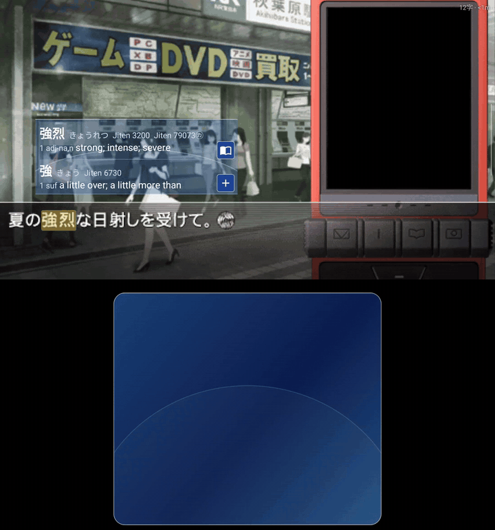
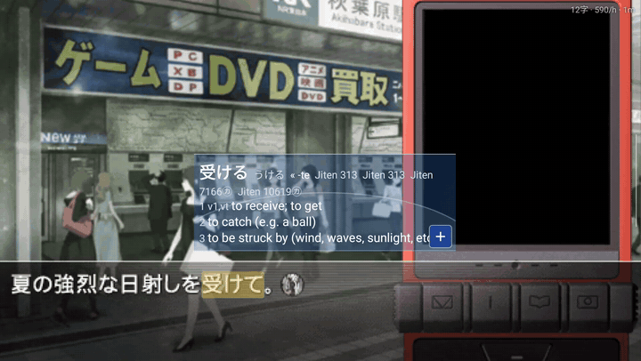
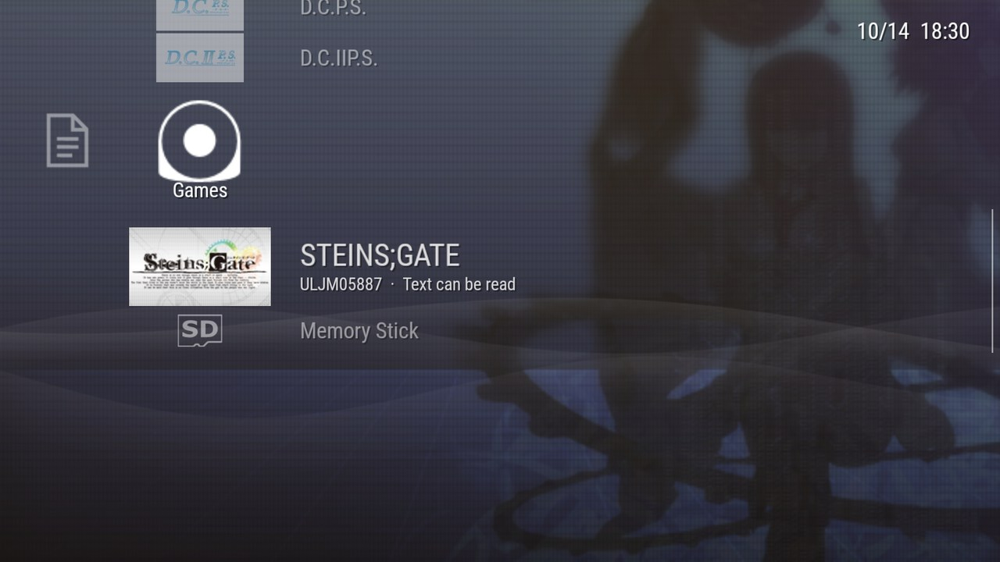
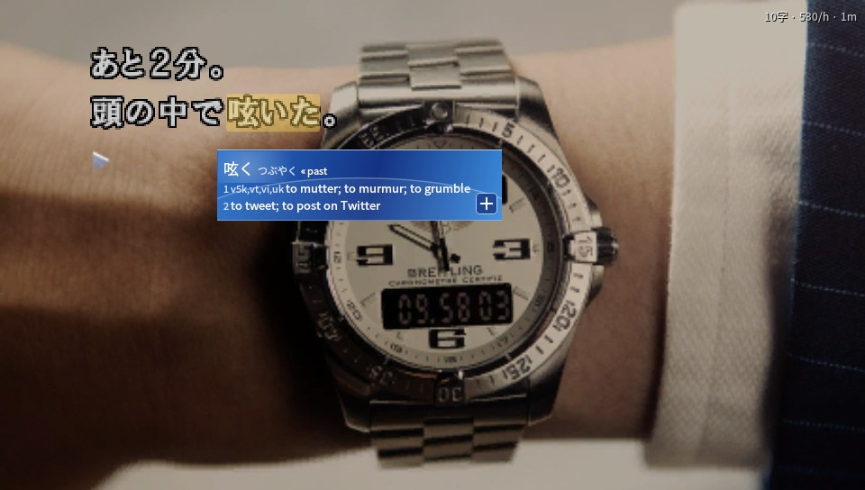
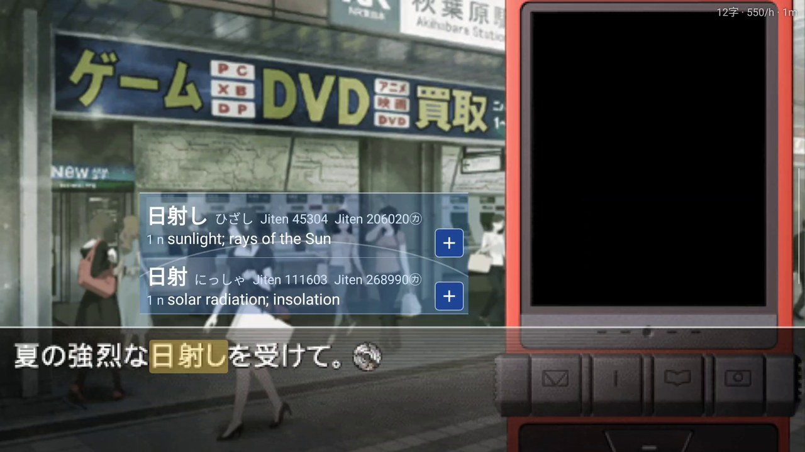
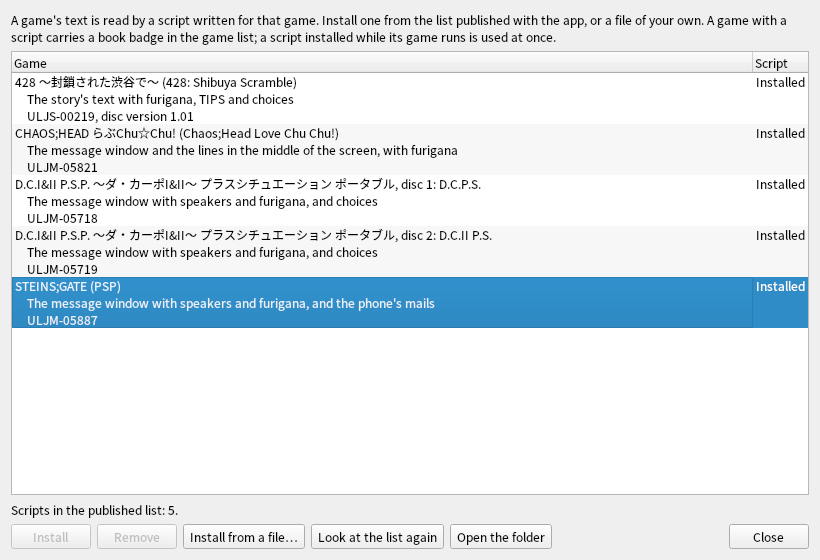
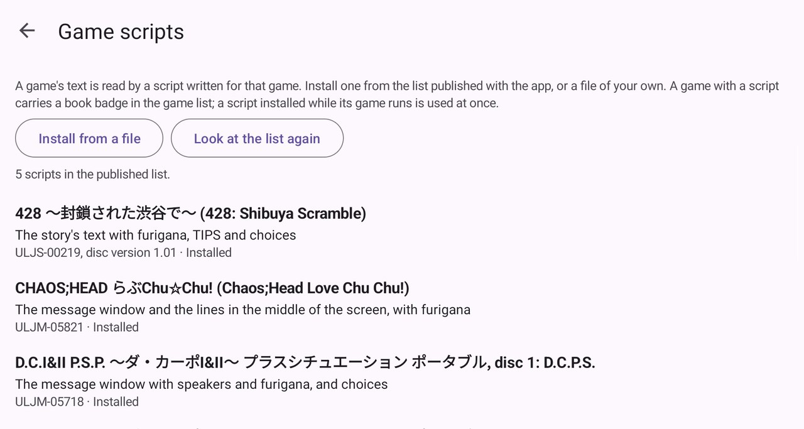

# PPSSPP Reader

Read Japanese PSP games the way you read a visual novel in a browser with Yomitan: tap or
click a word **in the game's own text** and its dictionary entry opens, make an Anki card of it,
and your reading is counted. Nothing is drawn over the game.

For Android handhelds and phones, and for Windows (and Linux, built from source).

<table>
  <tr>
    <td width="50%"> <b>On a computer:</b> click a word (428 ～封鎖された渋谷で～).</td>
    <td width="50%"> <b>On a two-screen handheld:</b> the lower screen is the cursor's trackpad (STEINS;GATE).</td>
  </tr>
  <tr>
    <td> <b>On one screen:</b> touch the word.</td>
    <td> <b>The PSP's own look:</b> the XMB, a game with a script marked "Text can be read".</td>
  </tr>
</table>

> PPSSPP Reader is a fork of the [PPSSPP](https://github.com/hrydgard/ppsspp) emulator (v1.20.4)
> with a reading layer on top. **It is not PPSSPP and is not supported by the PPSSPP project**:
> please report nothing about it there. PPSSPP's own README is [README.ppsspp.md](README.ppsspp.md).
> The reading layer's code is AI-written; nothing from here is to be sent upstream.

## What it does

- **Look words up in the game's picture.** A word in a text box is real text: click or touch
  it, or move the reader's cursor onto it (on a two-screen handheld the second screen is its
  trackpad), and a popup shows its entries from the dictionaries you installed (dictionaries
  made for Yomitan). Inflected words are traced back to their dictionary form.
- **Cards.** A card of the word with the line and a picture of the scene, in AnkiDroid or in
  Anki on a computer.
- **Backlog and statistics.** Every line read, characters per hour, time per day and game.
- **Save sync** between your devices, through a service of your own.
- **The PSP's own look.** An XMB-style main screen, and the reader's popup in its colours.
- It only does this for **games that have a game script** (below). Every other game runs as
  in PPSSPP.

## What it looks like

<table>
  <tr>
    <td width="50%"> <b>A lookup on a computer.</b> 呟いた is looked up as 呟く.</td>
    <td width="50%"> <b>Two screens.</b> The lower screen moves the cursor, so a hand never covers the game.</td>
  </tr>
  <tr>
    <td> <b>One screen.</b> Touch the word.</td>
    <td> <b>The CRT picture</b> (Reader settings): scan lines, a bulging tube, glow. Lookups follow the bent glass.</td>
  </tr>
  <tr>
    <td> <b>Game scripts</b> on a computer: the published list, with Install, Update and Remove.</td>
    <td> <b>Game scripts</b> on Android.</td>
  </tr>
</table>

The computer pictures are of the Linux build (the same app as the Windows package); the
handheld ones of an AYN Thor. The dictionary is JMdict.

## Get it

From the [releases](../../releases) of this repository:

| File | For |
| --- | --- |
| `PPSSPPReader-<version>-windows.zip` | Windows. Unpack anywhere, start `PPSSPPQt.exe`. |
| `PPSSPPReader-<version>-android.apk` | Android (arm64). Installs beside PPSSPP and shares nothing with it. Signed with a development key, not a store's. |

As with PPSSPP, you bring your own games, dumped from your own discs.

**How far it has been tried**: the games were read on Linux in the desktop app and in the
headless harness; on an AYN Thor, 428 and STEINS;GATE were read (STEINS;GATE with the second
screen's trackpad and by touch), and the Game scripts screen fetched the published list. The Windows package is built on Linux and **has not yet been started
on Windows**. [AGENTS.md](AGENTS.md) and each game's notes in
[docs/reader/games](docs/reader/games) say what is there and what is not.

## Game scripts

The emulator knows where a game keeps its text only from a **game script** written for that
game: a small Lua file named after the game's ID (`ULJS00219.lua`) that reads the game's memory
and says what text is on the screen and where each character stands. The apps come with none.
They install them from **the published list** in this repository
([`assets/reader/profiles`](assets/reader/profiles), listed in
`assets/reader/profiles/index.json`):

- **Game scripts** (in the XMB's Reader column; on a computer also **Reader → Game
  scripts…**) shows the games of the list and the scripts you have, and installs, updates and
  removes them. A script installed while its game runs is used at once.
- **Install from a file** takes a script of your own (and a data file it asks for). A script
  can also be put by hand into the app's `reader/profiles` folder.

A game with a script carries a book badge in the game list. New games are added to the list
without a new release of the apps.

**Games in the list**: 428 ～封鎖された渋谷で～, STEINS;GATE, CHAOS;HEAD らぶChu☆Chu!, D.C.I&II
P.S.P. (both discs), and the games added since.

### Writing a script

A script holds **addresses and decoding logic only**: no text, pictures or tables taken from
the game. [AGENTS.md](AGENTS.md), "Adding a game", is the way: the headless harness that runs a
game and is driven while a script is written, the API (`reader/core/lua_api.cpp`), and each
finished game's notes in `docs/reader/games`. Most of the scripts here were written by an AI
agent working from those notes; that is a fine way to make one. Before sending one in: say
which disc (ID and version; the script checks the program's checksum), what was seen read, and
how far into the game. Pull requests with new scripts are welcome;
`tools/reader/scripts-index.py assets/reader/profiles` makes the list.

## Building

[AGENTS.md](AGENTS.md) says how the Android app, the Linux app and the Windows package are
built and tested.

## Licence

GPL-2.0-or-later, as PPSSPP (see [LICENSE.TXT](LICENSE.TXT)). Henrik Rydgård and PPSSPP's
contributors made the emulator; the reading layer is in `reader/` and
`android/src/org/ppsspp/ppsspp/reader`, and the upstream files it touches carry a comment that
begins `Reader fork`.
